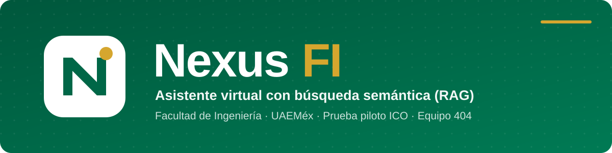
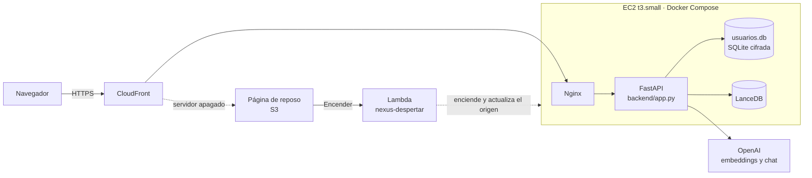

<p align="center">
  
</p>

<p align="center">
  
</p>

<p align="center">
  
  
  
  
  
  
</p>

**Nexus FI** responde preguntas de la comunidad de la Facultad de Ingeniería de la UAEMéx (trámites, servicio social, titulación, becas, horarios y normativa) **con base en documentos oficiales y citando la fuente**. Si el acervo no tiene la respuesta, lo dice en lugar de inventarla.

> **Estado:** prueba piloto para Ingeniería en Computación (ICO), en producción en **https://d2j5rd06t9r4yq.cloudfront.net**. Acceso con número de cuenta precargado. Proyecto de la UA *Administración de Proyectos Informáticos* (2026-B) · Equipo 404.

## ✨ Qué hace

- **Respuestas con fuentes (RAG):** busca en 198 documentos (3,340 fragmentos) y cita cada fuente; cada cita abre el **PDF original en la página citada** o, para las fuentes piloto, su texto.
- **Conversaciones con memoria:** historial por usuario (cifrado) y preguntas de seguimiento como «¿y cuál es el plazo?», que se reescriben antes de buscar.
- **Dos modelos a elegir:** *Rápido* (gpt-4o-mini, 20 consultas por hora y 60 por día) y *Avanzado* (gpt-6-luna, 5 por hora, respuestas más completas).
- **Tablas, listas y formato** en las respuestas; interfaz para escritorio y celular, con modo oscuro.
- **Tablero de usuario y panel admin** con datos reales: consultas, temas, cuotas, costo por modelo, latencia y preguntas sin respuesta.
- **Apagado automático:** el servidor se apaga a los 15 minutos sin uso y se enciende desde la página «Nexus FI está en reposo» en menos de 2 minutos.

## 🏛️ Arquitectura



## 🚀 Uso local

```bash
git clone https://github.com/igream/Nexus-FI.git && cd Nexus-FI
python -m venv .venv && .venv\Scripts\activate      # Linux/macOS: source .venv/bin/activate
pip install -r requirements.txt
```

1. Copia desde un equipo donde ya funcione (nunca por Git): **`.env`** (claves; plantilla en `.env.example`) y **`data/lancedb/`** (base vectorial, ~28 MB).
2. Inicia con `start.bat` (Windows) o `python main.py --serve` y abre http://127.0.0.1:8000.

| Tarea | Comando |
| :--- | :--- |
| Servidor sin límite de consultas | `python main.py --serve --dev` |
| Pruebas automáticas | `python -m pytest tests -q` |
| Diagnóstico de claves y base | `python main.py --telemetry` |
| Comparar modelos | `python scripts/comparar_modelos.py` |
| Cuentas ficticias de prueba | `python scripts/precargar_cuentas.py --ficticias` |
| Preparar los PDF originales | `python scripts/preparar_acervo_original.py` |

## ☁️ Despliegue

- **EC2** (us-east-2) con Docker Compose (`nexus_backend` + `nexus_proxy`); `data/` se monta como volumen. Actualizar: `git pull && docker compose up -d --build`, previo respaldo de `data/usuarios.db` y `.env`.
- **PDF de las citas:** `scripts/preparar_acervo_original.py` y subir `data/acervo_original/` al servidor.
- **Apagado automático (F5):** pila CloudFormation `infra/f5/apagado.yaml` (alarma de NetworkIn < 8 KB en 15 min, Lambda y página de reposo). Se despliega y calibra con `scripts/f5_desplegar.py`.

## 🔒 Seguridad

Número de cuenta y nombre cifrados (Fernet + HMAC), contraseñas con bcrypt, sesión JWT de 8 horas y bloqueo tras 5 intentos. El historial se guarda cifrado. `.env` y `data/` nunca van a Git; `python main.py --audit` busca secretos antes de un commit.

## 📚 Documentación

- [Plan de implementación post-piloto](docs/PLAN_IMPLEMENTACION.md): fases F1 a F5, decisiones y bitácora.
- [Comparación de modelos](docs/02_Ejecucion/COMPARACION_MODELOS_2026-11-10_0150.md): por qué gpt-6-luna.
- [`CLAUDE.md`](CLAUDE.md): estado del proyecto y contexto para agentes de desarrollo.
- Swagger de la API en `/docs`; entregables del curso en `docs/01_Planeacion` y `docs/02_Ejecucion`.

## 👥 Equipo 404

| Integrante | Rol |
| :--- | :--- |
| Fernando Azuara Ibarra | Project Manager, integración y base vectorial |
| Joaquín Ulises García Álvarez | Seguridad y backend |
| Daniel Aguilar Sánchez | Frontend |
| Joan Alexis Ocaña Martínez | Frontend |
| Ángel Israel de la Cruz Martínez | DevOps y cloud |
| Aarón Nevid Domínguez Fuentes | Pruebas (QA) y control de cambios |
| Santiago Cuevas Sánchez | Gestión de datos |
| Azuleica Betsabel de la Cruz González | Gestión de datos |

<p align="center"><sub>Facultad de Ingeniería · Universidad Autónoma del Estado de México · Docente: I. en C. Cíntia González Mireles · 2026</sub></p>
