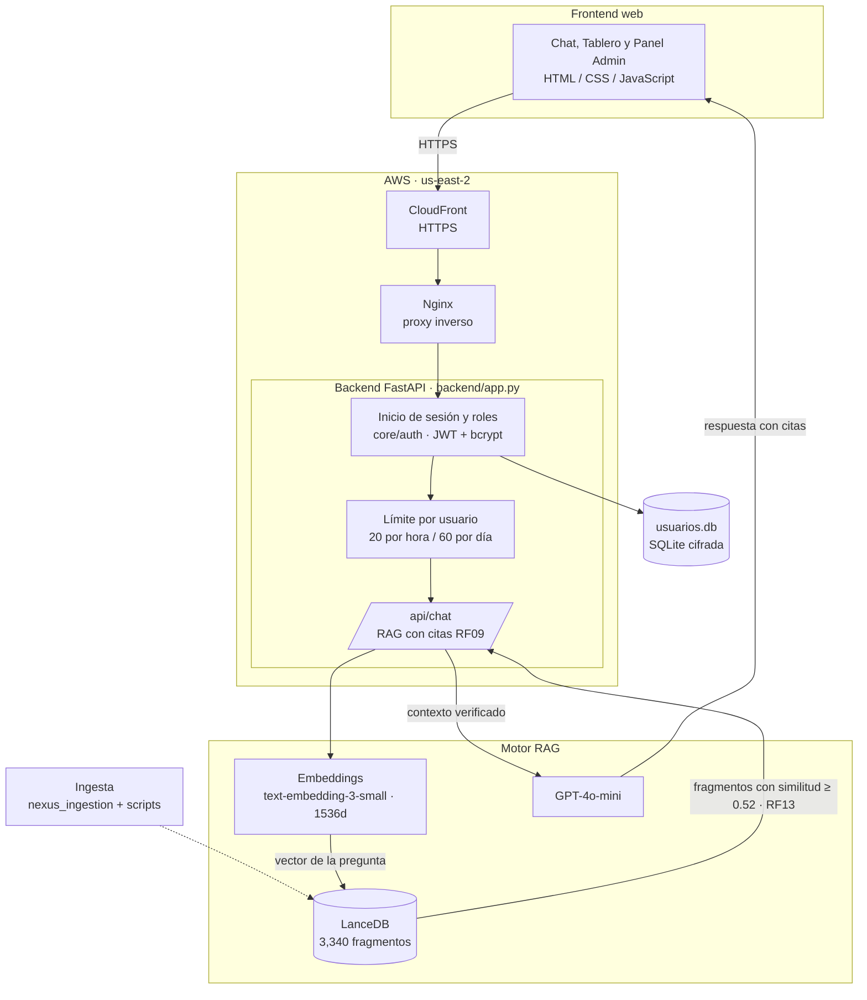

# Nexus FI — Asistente Virtual Inteligente (RAG)
### Facultad de Ingeniería · Universidad Autónoma del Estado de México (UAEMéx)
**Licenciatura en Ingeniería en Computación | Equipo 404**
**Project Manager:** Fernando Azuara Ibarra (`@igream`) · **Docente:** I. en C. Cíntia González Mireles
**Unidad de Aprendizaje:** Administración de Proyectos Informáticos (2026-B)

---

## 📌 Descripción General

**Nexus FI** es un asistente virtual basado en **Generación Aumentada por Recuperación (RAG)** que orienta a la comunidad estudiantil de la Facultad de Ingeniería de la UAEMéx. Responde sobre trámites escolares, servicio social, titulación, becas, horarios, avisos y normativa universitaria, y fundamenta cada respuesta en el acervo institucional citando sus fuentes (RF09). Si la pregunta no tiene respaldo en el acervo, lo indica en lugar de inventar (RF13).

**Estado actual:** prueba piloto para Ingeniería en Computación (ICO), definida por la Solicitud de Cambio SC-001 (29/10/2026). El acceso es con número de cuenta y contraseña, solo para cuentas precargadas, con un límite de 20 consultas por hora y 60 por día por usuario. La versión anterior, con filtro por IP, quedó en la etiqueta de Git `pre-SC-001`.

```
       _   _ _____ _   _ _   _ ____    _____ ___
      | \ | | ____| \ | | | | / ___|  |  ___|_ _|
      |  \| |  _| |  \| | | | \___ \  | |_   | |
      | |\  | |___| |\  | |_| |___) | |  _|  | |
      |_| \_|_____|_| \_|\___/|____/  |_|   |___|

   Asistente Virtual Inteligente con Búsqueda Semántica RAG
      Facultad de Ingeniería - UAEMéx | Equipo 404
```

---

## 🏛️ Arquitectura del Sistema



---

## 📁 Estructura del Repositorio

```
Nexus-FI/
├── backend/                     # API REST (FastAPI): chat RAG, métricas y archivos estáticos
│   ├── app.py
│   └── config_api/              # Diagnóstico de claves, auditor de secretos y catálogo de modelos
├── core/
│   ├── auth/                    # Inicio de sesión: almacén cifrado, tokens JWT, roles y rutas /api/auth
│   ├── chat/                    # Historial de conversaciones cifrado y rutas /api/conversaciones
│   └── security/                # Límite de consultas por usuario y utilidades de seguridad
├── frontend/                    # Chat, tablero de usuario y panel admin (responsivos, modo oscuro)
├── nexus_ingestion/             # Extracción, limpieza, segmentación, embeddings y LanceDB
├── fuentes_piloto/              # Fuentes limpias de la prueba piloto ICO (horarios, avisos, capítulos)
│   └── INVENTARIO.md            # Origen, responsable y fecha de cada fuente
├── Procesados/                  # Corpus segmentado listo para vectorizar
│   ├── 01_Normativa_Universitaria/ … 07_Fuentes_Piloto_ICO/
│   ├── corpus_chunks_para_embedding.jsonl
│   └── manifest.json
├── scripts/                     # Procesamiento, vectorización, cuentas y utilidades
│   ├── process_to_procesados.py # Pre Procesados → Procesados
│   ├── vectorize_corpus.py      # Procesados → LanceDB (overwrite o upsert por categoría)
│   └── precargar_cuentas.py     # Padrón de cuentas autorizadas y cuentas ficticias de prueba
├── tests/                       # Pruebas automáticas (pytest): login, límite, historial, búsqueda y caché
├── docs/                        # Documentación del proyecto (índice en docs/README.md)
│   ├── 00_Formatos/             # Plantillas oficiales y matrices de cumplimiento
│   ├── 01_Planeacion/           # Documento maestro e investigaciones previas
│   └── 02_Ejecucion/            # Asignaciones, entregas, informes, control de cambios y especificaciones
├── nginx/                       # Configuración del proxy inverso
├── Dockerfile · docker-compose.yml
├── setup.bat · setup.sh         # Instalación automatizada
├── start.bat · stop.bat         # Iniciar y detener el servidor en Windows
├── main.py                      # Punto de entrada (servidor, búsqueda por terminal, telemetría, auditoría)
├── requirements.txt
└── .env.example                 # Plantilla de variables de entorno
```

Fuera de Git (ver `.gitignore`): `.env`, `data/` (base vectorial y base de usuarios), `Pre Procesados/` (PDF originales) y `Local/`.

---

## 📊 Acervo y Base Vectorial

| Parámetro | Valor (3 de noviembre de 2026) |
| :--- | :--- |
| **Documentos** | 198 |
| **Fragmentos indexados** | 3,340 |
| **Categorías** | normativa, planes de estudio, becas, trámites, instalaciones y servicios, horarios, avisos y vida estudiantil |
| **Tamaño de fragmento** | 97 a 798 tokens (promedio 595), con solapamiento |
| **Motor vectorial** | LanceDB (`data/lancedb/`, ~28 MB) |
| **Modelo de embeddings** | `text-embedding-3-small` (1,536 dimensiones) |
| **Métrica** | Similitud coseno (1 − distancia) |
| **Umbral anti-alucinación (RF13)** | 0.52, con excepción para nombres propios poco comunes que aparecen tal cual (piso de 0.30) |
| **Citas (RF09)** | Documento, categoría, artículo o sección y relevancia |

El 3 de noviembre de 2026 se retiraron del acervo 24 documentos ajenos a la Facultad de Ingeniería (reglamentos internos de otras facultades, Educación Media Superior, Estudios Avanzados, Educación Continua y el Código de Ética de XHUAX), que hacían responder con normativa de otras facultades (cambio técnico CT-01).

**Actualizar el acervo:**
```bash
# 1. Reprocesar (Pre Procesados + fuentes_piloto → Procesados)
python scripts/process_to_procesados.py
# 2a. Regenerar la base completa (~0.04 USD en embeddings)
python scripts/vectorize_corpus.py --mode overwrite
# 2b. O actualizar solo algunas categorías (centavos)
python scripts/vectorize_corpus.py --mode upsert --categorias horarios,avisos,vida_estudiantil
```
En PowerShell, antes de los scripts que importan `nexus_ingestion`: `$env:PYTHONPATH = (Get-Location).Path`.

---

## 🔐 Inicio de Sesión, Roles y Límite de Consultas

- **Registro:** solo pueden crear contraseña las cuentas precargadas en el padrón de la prueba piloto (`scripts/precargar_cuentas.py`).
- **Almacenamiento:** número de cuenta y nombre cifrados (Fernet) con una huella HMAC-SHA256 para buscar; contraseña con bcrypt. Ningún dato se guarda en texto plano.
- **Sesión:** token JWT de 8 horas; bloqueo de 15 minutos tras 5 contraseñas incorrectas.
- **Roles:** los integrantes del equipo son administradores (Panel Admin, «Usuarios registrados» y reinicio de registro); el resto son alumnos.
- **Cuentas de prueba:** `1000001` a `1000009` (rol alumno). Si se registran para una prueba, se reinician al terminar:
  ```bash
  python scripts/precargar_cuentas.py --ficticias
  python scripts/precargar_cuentas.py --reiniciar-registro 1000009
  ```
- **Límite:** 20 consultas por hora y 60 por día por usuario, controlado por `RATE_LIMIT_ENABLED` en `.env` (si no existe, queda activo).

---

## 🔒 Política de Seguridad y Credenciales

1. `.env` (claves de OpenAI y del inicio de sesión) nunca se sube a GitHub; se comparte por privado.
2. `.env.example` lista las variables necesarias.
3. `python main.py --audit` busca cadenas sensibles en el código antes de un commit.
4. `data/` (base vectorial y de usuarios) y `Local/` quedan fuera de Git y de las imágenes de Docker (`.dockerignore`).
5. Nunca se escriben números de cuenta reales ni contraseñas en código, documentos o capturas de evidencia; para pruebas se usan las cuentas ficticias.
6. Si cambian `CUENTA_HMAC_KEY` o `CUENTA_FERNET_KEY`, la base de usuarios deja de servir.

---

## 🚀 Instalación y Uso

### Opción A: instalación automatizada (recomendada)

- **Windows:** ejecuta [`setup.bat`](setup.bat). Crea el entorno virtual, instala dependencias, prepara `.env` y valida la base vectorial. Después, para iniciar, usa [`start.bat`](start.bat).
- **Linux / macOS:**
  ```bash
  chmod +x setup.sh && ./setup.sh
  ```

### Opción B: instalación manual

```bash
git clone https://github.com/igream/Nexus-FI.git
cd Nexus-FI
python -m venv .venv
.\.venv\Scripts\activate          # Windows
source .venv/bin/activate         # Linux/macOS
pip install -r requirements.txt
copy .env.example .env            # y completar las claves
```

### Lo que `git clone` no trae
Cópialo desde un equipo donde ya funcione (USB o mensaje privado, nunca por Git):
1. **`.env`** → raíz del proyecto.
2. **`data/lancedb/`** → carpeta completa (~28 MB, 3,340 vectores). Regenerarla cuesta unos centavos de OpenAI (ver «Actualizar el acervo»).

Comprueba con `python main.py --telemetry` que aparezcan *LanceDB ONLINE* y 3,340 vectores.

### Ejecución

En Windows, **`start.bat`** muestra un menú (opción 1 a los 30 segundos) y abre el navegador:
1. **Solo este equipo:** `http://127.0.0.1:8000`
2. **En la red:** accesible desde otros equipos con la IP que muestra el menú.

**`stop.bat`** detiene todos los servidores de Nexus FI (útil si aparece *«solo se permite un uso de cada dirección de socket»*); `stop.bat -Listar` solo los muestra.

| Situación | Sin Docker | Con Docker |
| :--- | :--- | :--- |
| Servidor local | `python main.py --serve` | `docker compose up -d` |
| En la red | `python main.py --serve --host 0.0.0.0` | `docker compose up -d` |
| Desarrollo sin límite de consultas | `python main.py --serve --dev` | `RATE_LIMIT_ENABLED=false` en `.env` |

Otras herramientas:
```bash
python main.py --search "¿Cuáles son los requisitos para liberar el servicio social?"   # búsqueda por terminal
python main.py --telemetry                                                             # diagnóstico (DT-10)
python main.py --audit                                                                 # auditoría de secretos
python -m pytest tests -q                                                              # 78 pruebas automáticas
```

Páginas: chat en `/`, tablero en `/dashboard`, panel admin en `/admin-metrics` y documentación Swagger en `/docs`.

---

## ☁️ Despliegue en AWS

La prueba piloto está desplegada en **https://d2j5rd06t9r4yq.cloudfront.net** (acceso con cuenta precargada).

- **Instancia EC2** en us-east-2 (Ubuntu 24.04, t3.small, disco gp3 cifrado, IMDSv2) con `docker compose` (`nexus_backend` y `nexus_proxy`); `data/` se monta como volumen.
- **CloudFront** da HTTPS con su certificado y entrega el sitio sin caché.
- **Presupuesto** de 10 USD al mes con alertas y bloqueo automático; la instancia se detiene cuando no se usa (operar 24/7 costaría unos 21 USD al mes). Detalle en el reporte GP-09 (`docs/02_Ejecucion/Avance_3_100/Entregas/`).
- **Actualizar:** en la instancia, `cd ~/Nexus-FI && git pull && docker compose up -d --build`. Si cambia la base, copiar `data/lancedb` con `scp` y reiniciar el backend.

---

## 🔌 Referencia de la API

| Método y ruta | Uso | Acceso |
| :--- | :--- | :--- |
| `GET /health` | Verificación simple para el balanceador y CloudFront | Público |
| `GET /api/health` | Estado del servicio, la base vectorial y las claves configuradas | Público |
| `GET /api/stats` | Datos del acervo para el chat y el tablero | Público |
| `POST /api/auth/registro` | Crear la contraseña de una cuenta precargada (201, 403, 409 o 422) | Público |
| `POST /api/auth/login` | Iniciar sesión; regresa un token de 8 horas (429 tras 5 intentos fallidos) | Público |
| `POST /api/auth/logout` | Cerrar sesión e invalidar el token | Con sesión |
| `GET /api/session/info` | Usuario y cuota de consultas | Con sesión |
| `POST /api/chat` | Pregunta al asistente; regresa respuesta, citas, telemetría y `conversation_id` (429 al exceder el límite) | Con sesión |
| `GET /api/conversaciones` | Historial del usuario, de la conversación más reciente a la más antigua | Con sesión |
| `GET /api/conversaciones/{id}` | Mensajes de una conversación propia (404 si es ajena o se borró) | Con sesión |
| `PATCH /api/conversaciones/{id}` | Cambiar el título de una conversación propia | Con sesión |
| `DELETE /api/conversaciones/{id}` | Borrar una conversación propia | Con sesión |
| `GET /api/auth/admin/usuarios` | Cuentas registradas | Administrador |
| `POST /api/auth/admin/reiniciar-registro` | Borrar la contraseña de una cuenta para que se registre de nuevo | Administrador |
| `GET /api/v1/admin/metrics` | Consumo de tokens por clave e infraestructura | Administrador |

Ejemplo de consulta:
```json
POST /api/chat
Authorization: Bearer <token>
{ "query": "¿Qué documentos necesito para el certificado de servicio social?", "top_k": 4 }
```

---

## 🔀 Flujo de Trabajo con Git

- Cada tarea se desarrolla en una rama `feature/...` y se integra a `main` después de la revisión del PM.
- Los commits siguen el formato `tipo(ámbito): descripción` en español.
- `main` no se reescribe salvo para retirar información sensible; nunca se fuerza un push sin acuerdo del PM.
- La etiqueta `pre-SC-001` conserva la versión con filtro por IP, anterior a la prueba piloto.

---

## 👥 Equipo 404

| Integrante | Rol |
| :--- | :--- |
| Fernando Azuara Ibarra | Project Manager, integración y base vectorial |
| Joaquín Ulises García Álvarez | Seguridad y backend (inicio de sesión y límite de consultas) |
| Daniel Aguilar Sánchez | Frontend (interfaz, inicio de sesión y tablero) |
| Joan Alexis Ocaña Martínez | Frontend (interfaz, inicio de sesión y tablero) |
| Ángel Israel de la Cruz Martínez | DevOps y cloud (Docker, Nginx y AWS) |
| Aarón Nevid Domínguez Fuentes | Pruebas (QA) y control de cambios |
| Santiago Cuevas Sánchez | Gestión de datos (horarios y redes sociales) |
| Azuleica Betsabel de la Cruz González | Gestión de datos (capítulos estudiantiles y oficios) |

**Facultad de Ingeniería · UAEMéx · 2026**
